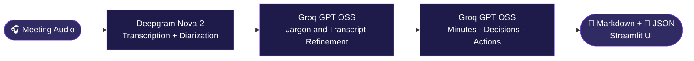

<div align="center">


<a href="https://git.io/typing-svg"></a>

<br/>

[](https://charan435.vercel.app)
[](https://www.linkedin.com/in/charan435)
[](mailto:charanm435@gmail.com)
[](https://github.com/charan-435)

<br/>


</div>

<br/>

<div align="center">

## ✨ About Me

</div>

<table align="center">
<tr>
<td width="55%" valign="top">

```python
class Charan:
    education  = "BTech @ IIT Guwahati"
    focus      = ["Machine Learning",
                  "LLM Pipelines",
                  "Full-Stack Web"]
    research   = "Metaheuristics + Deep Learning"
    domain     = "Medical imaging"
    shipped    = ["AI Meeting Assistant",
                  "Auto-ML", "Cinematic Lens"]
    exploring  = ["MLOps", "FastAPI", "Agents"]
    also       = "Competitive programming"
    motto      = "No toy projects. Only real ones."
```

</td>
<td width="45%" valign="top">

🎓 &nbsp;**BTech** at **IIT Guwahati**

🔬 &nbsp;**Researching** metaheuristic optimization for medical imaging

🎙️ &nbsp;**Built** an LLM meeting assistant for the **Inter-IIT ML Bootcamp**

🌱 &nbsp;**Deep-diving** into MLOps, FastAPI and LLM pipelines

🧩 &nbsp;**Practising** DP, Fenwick and segment trees

🤝 &nbsp;**Open to** ML, LLM-tooling and full-stack collabs

</td>
</tr>
</table>

<br/>

<div align="center">


## 🚀 Featured Projects

</div>

<br/>

<div align="center">

### 🎙️ AI Meeting Assistant
**Inter-IIT ML Bootcamp** · with [@Adith-Sree](https://github.com/Adith-Sree) · Team *Paradise*

*Turns raw meeting audio into transcripts, minutes, decisions and action items, without inventing deadlines.*


[](https://github.com/Adith-Sree/AI-Meeting-Assistant)
[](https://ai-meeting-assistant-hzp6gbfpbug6t6pxi2caep.streamlit.app/)

</div>



<table align="center">
<tr>
<td align="center" width="33%">🛡️<br/><b>Strict grounding</b><br/><sub>Missing owners and deadlines are marked <code>Unspecified</code>, never guessed</sub></td>
<td align="center" width="33%">🔍<br/><b>Auditable</b><br/><sub>Raw and refined transcripts shown side by side</sub></td>
<td align="center" width="33%">🔌<br/><b>Dual output</b><br/><sub>Markdown for people, schema-validated JSON for Jira, Notion and webhooks</sub></td>
</tr>
</table>

<br/>

<div align="center">

### 🧠 MOAOA Brain Tumour Classification
**Research implementation** of *MOAOA-FDL* · Multi-objective Archimedes Optimization with Fusion-based Deep Learning
<sub>Devanathan & Kamarasan, *Multimedia Tools and Applications* (2023)</sub>


[](https://github.com/charan-435/MOAOA-Brain-Tumour-Classification)

</div>



<br/>

<div align="center">


```mermaid
flowchart LR
    A([🧲 MRI Images]) --> B[Preprocessing<br/>CLAHE · Skull Strip · Augment]
    B --> C[Segmentation<br/>AOA + Shannon Entropy]
    C --> D[Tumor Extraction<br/>Morphology + Contours]
    D --> E[Feature Fusion<br/>MobileNetV2 + EfficientNet-B0]
    E --> F[AOA-tuned LSTM<br/>Classifier]
    F --> G([✅ Tumor / Normal])
    style A fill:#302b63,stroke:#7c3aed,color:#fff
    style G fill:#302b63,stroke:#7c3aed,color:#fff
    style B fill:#1e1b4b,stroke:#a78bfa,color:#fff
    style C fill:#1e1b4b,stroke:#a78bfa,color:#fff
    style D fill:#1e1b4b,stroke:#a78bfa,color:#fff
    style E fill:#1e1b4b,stroke:#a78bfa,color:#fff
    style F fill:#1e1b4b,stroke:#a78bfa,color:#fff
```

## 🗂️ More Work

</div>

<br/>

<table align="center">
<tr>
<td width="50%" valign="top" align="center">

### 🌫️ [Forecasting Air Quality Data](https://github.com/charan-435/Forecasting-Air-Quality-Data)
<sub>RESEARCH · TIME SERIES</sub>

Study of *A Novel Hybrid Approach For Efficiently Forecasting Air Quality Data*, with presentation slides.


</td>
<td width="50%" valign="top" align="center">

### 🔐 [URL Phishing Detection](https://github.com/charan-435/URL-Phishing-Detection)
<sub>MACHINE LEARNING · SECURITY</sub>

Feature engineering on raw URLs, multiple classifiers compared, with a full EDA and evaluation dashboard.


</td>
</tr>
<tr>
<td width="50%" valign="top" align="center">

### 🤖 [Auto-ML](https://github.com/charan-435/Auto-ML) · [Live](https://automl-one.vercel.app)
<sub>AUTOMATED ML · WITH <a href="https://github.com/Charanponaganti">@Charanponaganti</a></sub>

Automatic preprocessing, training and evaluation, deployed on Vercel.


</td>
<td width="50%" valign="top" align="center">

### 🎬 [Cinematic Lens](https://github.com/charan-435/Cinematic-Lens)
<sub>FULL-STACK · ANALYTICS</sub>

Movie analytics dashboard with a PHP and MySQL backend, filtering and dynamic rendering.


</td>
</tr>
<tr>
<td colspan="2" valign="top" align="center">

### 👾 [Space Shooter Game](https://github.com/charan-435/Space-Shooter-Game)
<sub>C++ · TERMINAL GAME</sub>

Real-time terminal shooter in pure C++ with adaptive difficulty: enemy speed and spawn rates rise as you play.


</td>
</tr>
</table>

<div align="center">

<sub>📂 More on my <a href="https://github.com/charan-435?tab=repositories">repositories tab</a> and <a href="https://charan435.vercel.app">portfolio</a></sub>

<br/>


## 🛠️ Tech Arsenal

</div>

<br/>

<div align="center">

**💻 Languages**<br/>
<br/><br/>

**🤖 AI / ML**<br/>
<br/>


<br/><br/>

**⚙️ Backend & Apps**<br/>
<br/>

<br/><br/>

**☁️ Deploy & Tools**<br/>
<br/>


<br/>


## 📊 GitHub Analytics

</div>

<br/>

<div align="center">


&nbsp;


<br/>


<br/>


<br/>


</div>


  

<div align="center">
  <picture>
    <source media="(prefers-color-scheme: dark)" srcset="https://raw.githubusercontent.com/charan-435/charan-435/output/github-snake-dark.svg" />
    
  </picture>
</div>


  
  [](https://codeforces.com/profile/charan_435)
  [](https://leetcode.com/charanm435)


<br/>

<div align="center">


## 🤝 Let's Build Something

*Open to collaborations on ML, LLM tooling and full-stack projects.*

[](https://charan435.vercel.app)
[](mailto:charanm435@gmail.com)
[](https://www.linkedin.com/in/charan435)

<br/>

<a href="https://git.io/typing-svg"></a>


</div>
